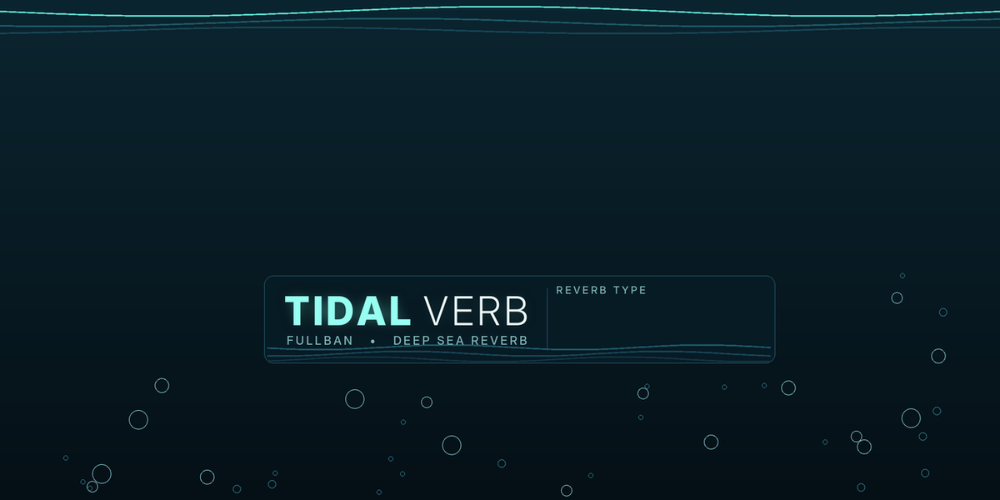

# Tidal Verb

A stereo reverb effect for Akai MPC / Force standalone, by Fullban. Built with the MPC Plugin SDK.



Ten reverb types (Room, Hall, Plate, Spring-style, Abyss, a cascading-octave Cascade shimmer and more), with **Decay, Liveliness, Swirl, Swirl Rate, Warmth, Air, Level** and a **Tails** switch. Eleven factory presets. The touchscreen skin has eight knobs that follow Q-Links and presets.

Inspired by the general idea of multi-voice pedal reverbs (a DigiTech Polara-style feature set). It is an original implementation and is **not affiliated with or endorsed by DigiTech/HARMAN or anyone else**.

## Install

* **Open MPC catalog** (root-modded devices): install from the catalog page, or unzip the release zip and run `install.sh`.
* **Official route** (MPC OS 3.10.1+, Preferences → Enhancements (Beta) → Enable Enhancements and VST2 Support): copy the `Fullban - VST - Tidal Verb` folder from the release into a `VST2 Plugins` folder on a drive.

## Build

```
release/build.sh          # zig cross-compile: arm32 + arm64, validated
```
Needs only Python 3 (zig is fetched as a pinned pip package). Release zips are produced by the *Release (draft)* workflow; see `docs/RELEASING.md`.

## Status (honest notes)

* Tested on real hardware by the author on a Force (Gen1) during development; automated host-simulator tests pass.
* CPU cost on Gen1 has not been benchmarked yet; use one instance on a busy project and watch the CPU meter.
* Parameter positions are fixed from 1.0.0 (new parameters are appended only).

## Licence

MIT, see `LICENSE`. SDK files are MIT too (`LICENSE-SDK`); see `THIRD_PARTY.md`.
